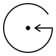
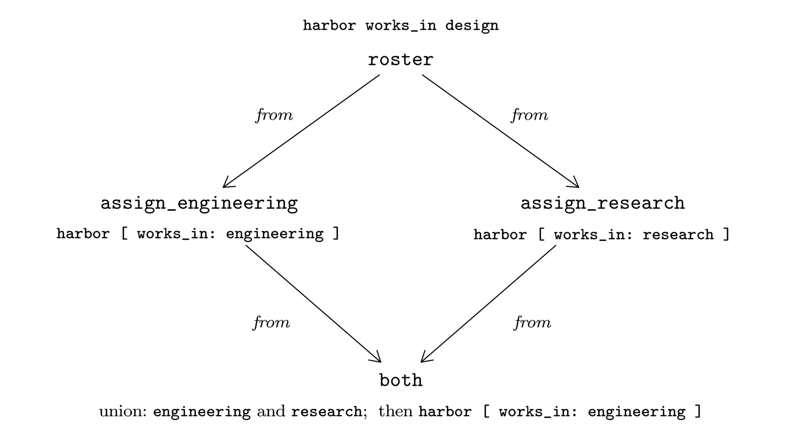
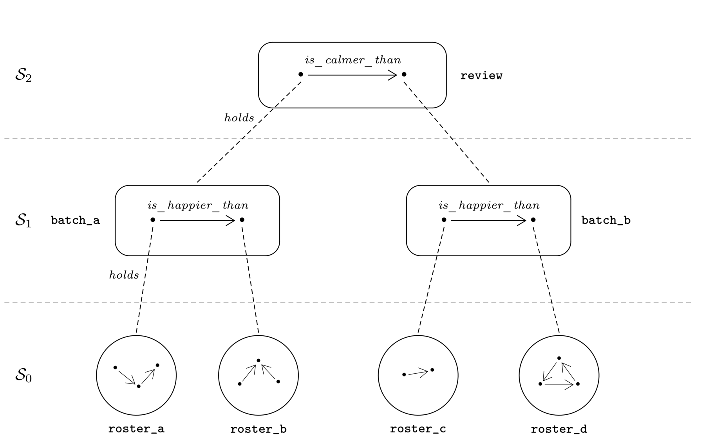

<p align="center">
  <picture>
    <source media="(prefers-color-scheme: dark)" srcset="logo/grant-mark-white.svg">
    
  </picture>
</p>

<h1 align="center">Grant</h1>

<p align="center">
  A language for describing worlds and changing them.<br>
  <a href="https://minimagate.github.io/grant-homepage/">The Grant Programming Language</a> ·
  <a href="docs/foundation-1.md">Specification</a> ·
  <a href="examples">Examples</a>
</p>

---

A **world** is a finite relational structure, `W = (K, O, F, R)`: kinds of things, the things themselves, the facts that relate them, and the rules that make further facts follow. In Grant every line states something about a world: a fact, a change, a definition or a question.

```grant
from numbers

kind team
kind feeling
kind person [
  age:       one number
  works_in:  one team
  knows:     person
  feels:     feeling
]

team design
team engineering
feeling happy

person liz    [ age: 27 | works_in: design ]
person laurie [ age: 30 | works_in: engineering ]
person harbor [ age: 24 | works_in: design | knows: liz, laurie ]
harbor feels happy

rule mutual: person a knows person b if b knows a

? liz.knows                    -- harbor
? person p works_in design     -- liz, harbor
? sum harbor.knows.age         -- 57
```

Nobody stated that liz knows harbor, and yet she does: the fact follows from the rule.

<p align="center">
  
</p>

This repository is the Rust implementation of **Foundation 1**. The specification is [`docs/foundation-1.md`](docs/foundation-1.md). Where it left a question open, the answer is recorded in [`docs/decisions.md`](docs/decisions.md).

## Install

Grant needs a Rust toolchain (1.88 or newer) and has no dependencies.

```sh
git clone https://github.com/minimagate/grant.git
cd grant
cargo install --path .
```

This puts the `grant` command in `~/.cargo/bin`.

## Use

```
grant <world>           run a world and show its questions
grant check <world>…    run worlds quietly and report only errors
grant show <world>      print everything stated in a world, parents included
grant watch <world>     run again whenever the world or anything it builds on changes
grant repl [world]      state lines one at a time, on a world or from nothing
```

A world is one file, named by it: `town.grant` is the world `town`, and `grant town` runs it. Each question is shown with its answer beneath it.

```
$ grant examples/harbor
? harbor is_at peace
  yes
? liz.knows
  harbor
```

Errors name the world, the line and the cause. A failing parent is reported with its own error.

```
error in child (child.grant, line 1): `town` has errors; fix it first
    1 | from town
error in town (town.grant, line 11): `venice` doesn't exist yet
   11 | harbor lives_in venice
```

In the REPL every line is a statement, as in a file. `:check` runs the end-of-world checks, `:show` prints what has been stated, and `:save name` writes your lines to `name.grant`.

## The ideas

### Worlds build on worlds

A world lists its parents with `from` and starts as their union. A child is not a copy of its parent plus a difference: it is a set of instructions applied to whatever its parent is. When a parent changes, the child is run again; `grant watch` shows this as you edit.

When two parents disagree, the merge does not fail. The child settles it the way anything is settled in Grant, by stating what is true, and the result is checked when the world ends.

<p align="center">
  
</p>

### Worlds are things

`world roster_a` holds another world as an object, the way `team design` makes a team. Relations between worlds are then ordinary facts, rules can produce them, and `in w:` asks a question inside a held world. A world only holds worlds from the levels below it, so no world can hold itself.

<p align="center">
  
</p>

### Equality compares shape

Two worlds are equal when they have the same kinds, rules and constraints, and their objects can be matched one to one so that every fact corresponds. Names don't matter.

<p align="center">
  
</p>

## The language in one page

| Line | Does |
| --- | --- |
| `from numbers, text, id, town` | starts the world as the union of its parents |
| `kind person [ age: one number \| knows: person ]` | declares a kind and its shape |
| `kind person [ + email: maybe text \| - age ]` | changes a shape |
| `person harbor [ age: 24 ]` | creates an object |
| `harbor knows liz` | adds a fact |
| `harbor [ lives_in: rome \| knows: + marco, - liz ]` | sets values; `+` and `-` add and remove single ones |
| `- harbor knows liz` · `- harbor knows` · `- harbor` | removes a fact, a relation's values, an object |
| `each person p where p.age < 18 [ age: p.age + 1 ]` | the same change on every match |
| `rule adult: person p is adult if p.age >= 18` | a fact that follows |
| `never sensible: person p where p.age > 150` | a pattern that must have no matches at the end |
| `world town_a` | holds another world as an object |
| `? person p lives_in pisa and not p knows person q` | asks: a value, yes or no, or every match |
| `? in town_a: harbor.knows` | asks inside a held world |
| `the harbor [ lives_in: rome ]` | points at the one object a description fits |

Values: `harbor.knows.age` follows relations; `+ - * / div mod`, `< > <= >= = !=`, `count`, `sum`, `min`, `max`. Numbers are exact (`1 / 3` stays a third). There are no booleans, no null and no lists: truth is whether a fact exists.

## Examples

[`examples/department`](examples/department) is a whole project written from nothing: ten worlds in which a mathematics department plans its teaching, merges two timetables, judges them from a world that holds them, and lets a year pass.

```sh
cd examples/department
grant review
grant watch review      # then edit people.grant, or a plan, and watch the verdict move
```

The rest of [`examples`](examples) has the worlds of the specification, a merge to settle, worlds compared as objects, and a calendar built on `numbers`. The example files carry no comments; [`examples/README.md`](examples/README.md) explains each one.

## Editor support

[`editors/vim`](editors/vim) has syntax highlighting for Vim and Neovim. Copy or link `syntax/grant.vim` and `ftdetect/grant.vim` into your config folder (`~/.config/nvim`).

## The implementation

| File | Holds |
| --- | --- |
| `src/lexer.rs`, `src/parser.rs`, `src/ast.rs` | text to statements; names are read by where they stand |
| `src/world.rs` | the world structure, identity by origin, and merging parents |
| `src/compile.rs`, `src/logic.rs` | names given their meaning: variables, or the objects handles point at |
| `src/eval.rs` | values and conditions |
| `src/model.rs` | derived facts (stratified, to a fixed point) and the end-of-world checks |
| `src/exec.rs` | what each line does |
| `src/loader.rs` | files, parents, held worlds, and the refusal of cycles |
| `src/equal.rs` | equality of shape between worlds |
| `src/show.rs`, `src/main.rs` | printing worlds, and the `grant` command |

The crate is also a library: `grant::Loader` runs files and `grant::Session` states a world line by line.

```sh
cargo test      # the specification's examples, every error of section 15, and the department project
```

The logo and its construction are in [`logo`](logo).
